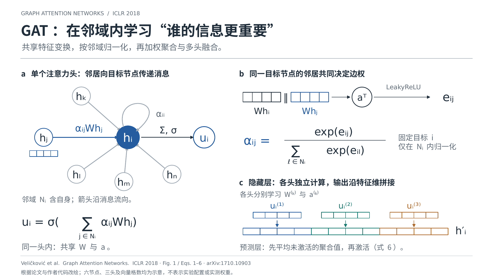

# 单页学术 PPT：从科学关系到可编辑页面

本入口直接交付一页。页面应让读者看清一个有来源的科学主张；标题、主图、公式和必要解释共同服务于这个主张。图中的空间、形状、重复对象和连线必须承载意义。区域划分用于组织代码和局部修改，不会自动画出边框或卡片。

## 实际借鉴了什么

核查日期：2026-11-23。阅读了作者实现，没有下载权重、运行作者模型、训练模型或复制其实现。

| 来源与固定版本 | 作者代码中的方法 | 本项目的落点 |
| --- | --- | --- |
| [AutoPresent](https://github.com/para-lost/AutoPresent/tree/98e0c012e89469863d9c3c8bc87eac967d82b2e6) | `generate/create_slide_deck.py` 区分输入完整度；`create_slide.py` 提供高层 API 文档；`refinement/refine.py` 同时读取原要求、旧代码和当前渲染图。 | 先说明输入有什么、缺什么；使用小型组合接口；修订时保留原稿和实际渲染证据。 |
| [SlideCoder](https://github.com/vinsontang1/SlideCoder/tree/c71faa5b76caaa09e407e17c845bbabc0ed8a3fa) | `get_description_AIagent.py` 保存区块 ID、位置、尺寸与描述；`generated_ppt_code_AIagent.py` 逐块生成再组装。 | 将单页拆成隐形区域，统一坐标、保存稳定 ID，确定性组装同一页。 |

AutoPresent 的视觉修订返回整段新程序，并没有提供这里的局部补丁函数。SlideCoder 检查到的调试循环主要处理执行异常，不能据此声称它已完成科学或视觉验收。本项目新增的 `revise_region` 是在这些方法启发下实现的局部修改能力。

AutoPresent 仓库根目录许可为 MIT；本次仅在 SlideCoder 的 `SlideMaster/` 子目录看到 Apache 2.0 许可，未把该许可推及全库。本轮只借鉴方法，未搬运作者代码或模型。

## 一页怎样开始

1. 写出一句主张，识别已有论文、代码、数据、源图与资产。只有主题时，可以提出构图和待补来源；不能补造科研事实。有论文原图时，实际查看图像与图注。
2. 将主张翻译成可见关系。列出图中对象、变化、关系、索引与必要例外，再选图元。主图由机制决定；模块名称不是完整的视觉解释。
3. 画幅只分成必要的隐形区域，例如主图、公式展开、结论和来源。保留重点大小与阅读顺序，不追求各区等宽等高。
4. 生成一页可编辑 PPTX，导出实际 PPTX 预览。将原要求、旧规格和预览一起交给修订步骤，定位具体问题，修改相应区域，重新查看整页。

### 小型能力索引

| 科学关系 | 合适的可编辑表达 | 使用边界 |
| --- | --- | --- |
| 邻域聚合 | 带索引的节点、定向消息、自环、求和符号 | 节点/边来自真实方法；示意数量明确说明；无数据时不按边宽暗示权重。 |
| 特征拼接 | 沿特征轴接续的分段向量；各输入对应自己的输出段 | 不能用无标注的汇聚点代替拼接；示意格数不代表真实维度。 |
| 特征求和 | 多输入进入明确的 `+` / `Σ`；标出求和索引 | 与拼接、平均分别表达。 |
| 多个独立头 | 并列的同类计算或输出，独立参数和头索引 | 不画成头与头之间串行传递。 |
| 定量比较 | 原始数据经现有 chart 工具得到坐标、刻度、区间 | 不使用装饰性柱形、热图或任意数值冒充结果。 |

已有 `ml_figure_components.py` 的组件返回 `ports`、`bounds` 和 `visual_bounds`；布局应计入标签等完整可见范围。这里的索引是起点，不能限制其他学科的图形语言。

## 可运行的单页入口

依赖沿用现有 renderer：Python 与 `python-pptx`。示例使用 Noto Sans CJK SC 和 DejaVu Sans；字体替换后必须重新查看实际 PPTX 渲染。

```bash
# 保留第一次生成，供之后比较。
python tools/build_gat_single_page.py --output-dir dist/single_page/gat_initial

# 应用实际看过第一版后记录的局部修订。
python tools/build_gat_single_page.py \
  --output-dir dist/single_page/gat_final \
  --review examples/single_page/gat_review_revision.json

# 用已有单页 JSON 直接重建。源码区域仍保留在 JSON 中。
python tools/single_page_composer.py examples/single_page/gat.json \
  --output-dir dist/single_page/gat_rebuild
```

输出为 JSON、SVG 与恰好一页的 PPTX；科学来源和简化说明进入讲者备注。最终结果应从 PPTX 导出查看；SVG 预览不能证明字体、换行和箭头在办公软件中一致。例如本轮使用 LibreOffice 导出 PDF，再用 Poppler 转 PNG，没有声称经过 Microsoft PowerPoint 实机检查。

### 组合与局部修改

页面仍使用原来的 FigureSpec 图元，只多一层轻量区域信息，没有另建强制的 DeckSpec 或科学流程门禁。

```python
from single_page_composer import render_page, revise_region

page = {
    "id": "my_single_page",
    "canvas": {"width_in": 13.333, "height_in": 7.5},
    "claim": "A sourced claim",
    "sources": [{"url": "SOURCE_URL", "locator": "Figure / equation / code"}],
    "regions": [{
        "id": "mechanism",
        "bounds": {"x": 0.6, "y": 1.5, "w": 8.0, "h": 5.0},
        "spec": existing_figure_spec,
    }],
}
render_page(page, "output/initial")
# revised_figure_spec is authored after inspecting output/initial's PPTX render.
revised = revise_region(page, "mechanism", {"spec": revised_figure_spec})
render_page(revised, "output/revised")
```

Use explicit element IDs. Geometry is uniformly fitted and centered within each region; no visible container is generated. All supported primitive coordinates, text sizes and exposed line dimensions are transformed. Prefer final-size composition because the unchanged renderer has some fixed text margins and internal line details.

`revise_region` preserves the target ID and deep-copies the input. Unmentioned sibling regions remain unchanged. A replacement `spec` replaces that entire field. A line crossing regions must be revised explicitly with its endpoint regions; the tool does not infer scientific connectivity, reroute connectors, detect every overlap, score aesthetics, or parse arbitrary paper/code content.

## 本轮 GAT 页的来源和观察



该页是机制解说改绘，不是原图的像素复刻或实验结果。科学内容来自 [GAT 论文 v3，§2.1、图 1、式 (1)–(6)](https://arxiv.org/pdf/1710.10903v3) 与 [作者代码固定提交](https://github.com/PetarV-/GAT/tree/5af87e7fce2b90ae1cbd621cd58059036a3c7436)。`utils/layers.py` 支持共享投影、成对打分、masked softmax 和加权聚合；`utils/process.py` 支持邻域与自环；`models/gat.py` 支持独立头、隐藏层拼接和输出头平均。

- a/b 展开一个头，省略头上标；`uᵢ` 是该头激活后的聚合输出。c 再展示独立执行的三个头。颜色与形状均有具体作用。
- 同一目标节点的邻域（含自身）参与 softmax；先聚合邻居，再激活。预测层按论文式 (6) 先平均未激活的聚合值，再作最终激活。
- 六个节点、三个头及向量格数都是示意；没有测得的权重值，也不代表 Cora 的实际配置。训练 dropout、bias、损失和实验超参数省略，详细区别在讲者备注中。
- 第一版多头箭头汇于一点，容易误读为求和。修订后每个头分别落入对应的拼接段；求和公式改为分开的原生符号与索引；辅助说明缩短并放大。原稿与局部修订数据保留，可重跑。
- 公式是原生可编辑文字和符号，不是 Office Math 对象。本轮独立 agent 做了来源和图面复核；这不等于外部领域专家审查或跨学科泛化评测。

机器检查覆盖新组合/局部修订的实际边界，页面审计检查越界、文本框相交和原生对象情况。单页可重现、机器检查通过和图面复核是不同证据；它们都不能证明模型权重接入、训练成功或通用科研图质量。
